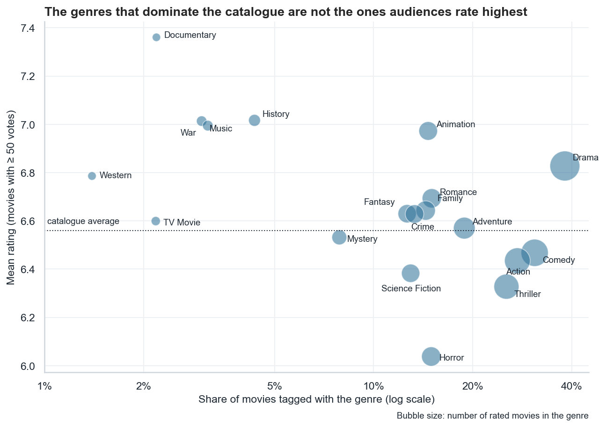
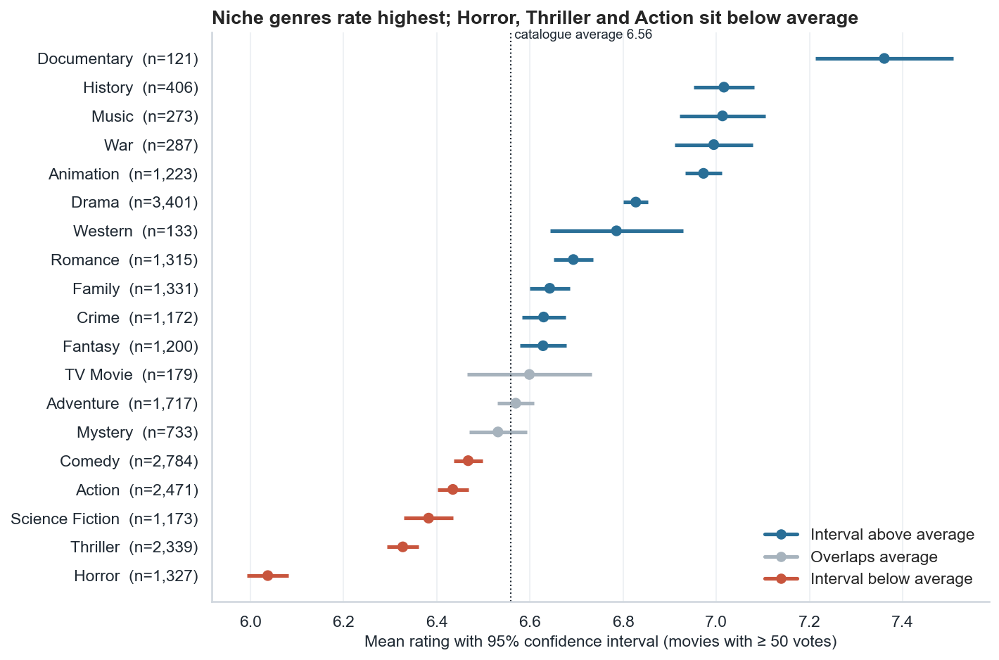
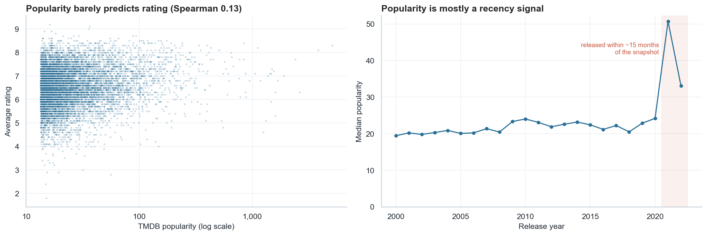
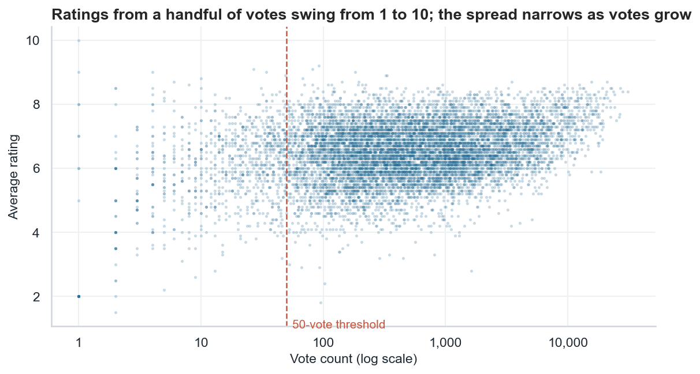
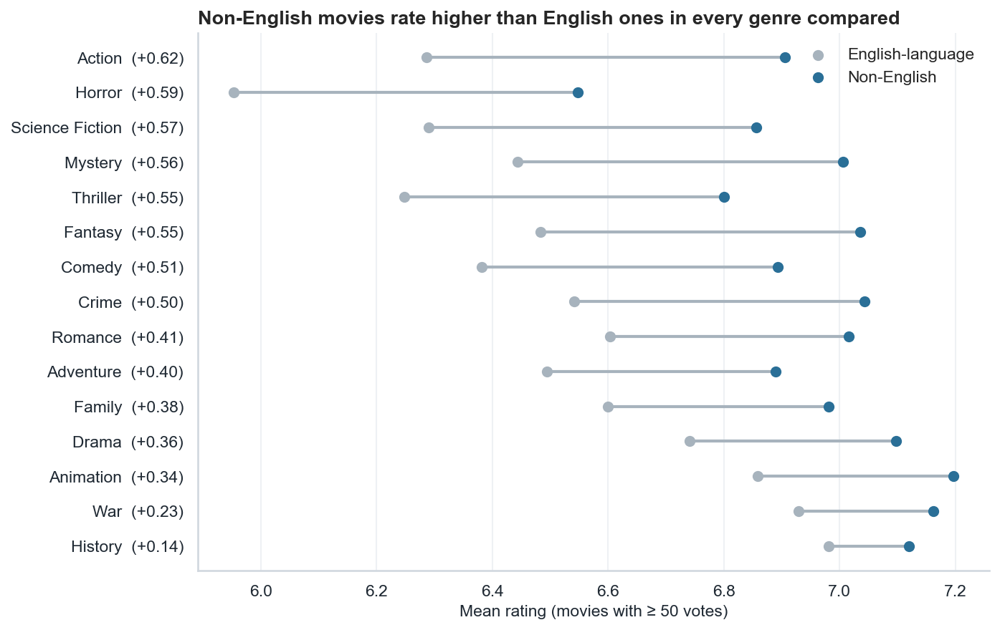

# Movie Catalogue Analytics: Genre Performance, Rating Reliability and Content Discovery

A Python case study of 9,827 popular TMDB movies, showing how a streaming service could use catalogue data to judge genre performance, choose trustworthy ranking signals and find under-exposed, well-rated titles.

> Simulated business case study on a public dataset. It is not analysis commissioned by any company, and the data contains no viewing, revenue or subscriber information.



## Business problem

A streaming or entertainment company wants to use catalogue metadata to make better **content-discovery and catalogue-planning decisions**: which genres audiences rate well, which signals to trust when ranking titles, and which well-liked titles get little attention.

## Analytical questions

| # | Question | Decision it informs |
|---|---|---|
| Q1 | Which genres make up the catalogue, and how much do they overlap? | Catalogue description, browse taxonomy |
| Q2 | Which genres rate consistently better, after accounting for sample size? | Curation and acquisition focus |
| Q3 | Are popularity, vote count and rating interchangeable? | Which metric should drive each ranking |
| Q4 | How does the genre mix change across release decades? | Context for catalogue gaps by era |
| Q5 | Which movies are strong discovery candidates, and do international titles stand out? | Editorial rows, "hidden gems", international collections |

## Dataset

- **Source:** [9000+ Movies Dataset](https://www.kaggle.com/datasets/disham993/9000-movies-dataset) on Kaggle (`mymoviedb.csv`), collected from the TMDB API and sorted by popularity.
- **Size:** 9,827 movies × 9 fields: release date, title, overview, popularity, vote count, vote average, original language, genres and poster URL.
- **Snapshot:** the file has no collection date. The latest release date with any votes is 10 March 2022, so the data was pulled on or shortly after that.
- **Limitations:** it is the top slice of TMDB's popularity ranking at one moment (popularity never falls below 13.35), not a random sample of films. Ratings come from self-selected TMDB users.

The dataset is **not included in this repository**; see [Installation](#installation-and-running) for how to get it.

## Tech stack

Python · pandas · NumPy · SciPy · Matplotlib · seaborn · Jupyter · pytest

## Methodology

**Data cleaning** (`src/data_analysis.py`, row counts logged at every step)

- 15 data-quality checks on the raw file: missing values, duplicates, impossible values, unparseable and future dates, empty genres.
- **Duplicates:** 314 rows repeat a title, but none repeat title + release date. They are remakes and different films that share a name (for example *Aladdin* 1992 and 2019), so **no rows are removed**.
- **Zero-vote movies (100):** mostly 2022–23 releases that were trending before anyone rated them. They stay in the catalogue, but their placeholder 0.0 rating is set to missing.
- **Two tables:** `movies` (one row per movie, used for any movie count) and `movie_genres` (one row per movie per genre, used only for genre questions), so a movie with three genres is never counted as three movies.
- Assertions inside the pipeline, a validation cell in the notebook and 8 unit tests check these invariants.

**Analysis**

- **Rating reliability:** rating spread is twice as wide below 10 votes (SD 1.65) as above 1,000 votes (SD 0.77), so rating comparisons use movies with **≥ 50 votes** (8,796 movies).
- **Genre performance:** mean and median rating, **95% t-based confidence intervals** and the share of each genre's movies in the top rating quartile.
- **Metric relationships:** Pearson (raw and log-scaled) and **Spearman** correlations, plus median popularity by release year.
- **Decade trends:** genre shares with per-decade denominators; the incomplete 2020s are flagged.
- **Discovery shortlist:** a **vote-weighted (Bayesian-style) rating**, `v/(v+m)·R + m/(v+m)·C` with m = 555 and C = 6.56, tested against a stricter prior; a transparent "hidden gems" rule; a **within-genre comparison** of English and non-English titles.

## Key findings

1. **The most common genres are not the best rated.** Drama, Comedy, Action and Thriller each appear on 25–38% of movies, but Comedy, Action and Thriller rate *below* the 6.56 average. Documentary (7.36), History, Music, War and Animation (about 7.0) rate highest, each with a confidence interval entirely above average. Horror is lowest (6.04).
2. **Popularity is a recency signal, not a quality signal.** Its Spearman correlation with rating is 0.13. Median popularity is 20–24 for release years 2010–2020 and jumps to about 51 for 2021 releases.
3. **Raw ratings mislead at low vote counts.** 7 of the 10 highest raw ratings have fewer than 350 votes. Vote-weighting moves them to rank 500–2,300; 11 of the top 15 and 42 of the top 50 stay the same under a stricter prior.
4. **Non-English titles rate higher in every genre compared,** by 0.14 to 0.62 points, across 15 genres. This is likely partly selection bias (only acclaimed international films reach an English-leaning popularity list), so it is a hypothesis to test, not a proven effect.
5. **234 "hidden gems"** sit in the top 10% by weighted rating but the bottom half by popularity; 54% were released before 2000 and 32% are non-English.

| | |
|---|---|
|  |  |
|  |  |

## Business recommendations

Each is grounded in a calculated finding; anything about commercial impact would need data this project does not have.

1. **Rank "highly rated" surfaces by vote-weighted rating** and keep popularity for "trending now" only. *KPI:* click-through and completion rate per surface.
2. **Treat Documentary, History, Music, War and Animation as curation themes**, not volume targets: they rate highest but are small. *Risk:* their raters are self-selected fans.
3. **Pilot a "hidden gems" row** in an A/B test against the current default row. *KPI:* starts and completions from the row vs control.
4. **Pilot an international-picks collection**, starting with the genres with the largest rating gap (Action, Horror, Science Fiction). *Risk:* selection bias; subtitles and dubbing affect uptake.
5. **Report catalogue mix and audience reception as separate metrics** in planning reviews.

The full table, with rationale, risks and KPIs, is in Section 8 of the notebook and in [reports/executive_summary.md](reports/executive_summary.md).

## Repository structure

```
movie-data-analytics/
├── README.md
├── requirements.txt
├── .gitignore
├── data/
│   └── README.md               # how to obtain mymoviedb.csv (data itself not committed)
├── notebooks/
│   └── movie_data_analysis.ipynb   # the full analytical report, with outputs
├── src/
│   └── data_analysis.py        # cleaning pipeline, metrics, chart style
├── tests/
│   └── test_data_analysis.py   # unit tests for cleaning and metrics
├── reports/
│   ├── executive_summary.md
│   └── project_audit.md        # what changed from the first version and why
└── images/                     # charts generated by the notebook
```

## Installation and running

```bash
git clone https://github.com/manasvimittal27/movie-data-analytics.git
cd movie-data-analytics
python -m venv .venv && source .venv/bin/activate   # Windows: .venv\Scripts\activate
pip install -r requirements.txt
```

1. Download `mymoviedb.csv` from the [Kaggle dataset page](https://www.kaggle.com/datasets/disham993/9000-movies-dataset) and save it as `data/raw/mymoviedb.csv`. (Or set the `MOVIE_DATA_PATH` environment variable to wherever the file is.)
2. Run the tests: `pytest`
3. Open the notebook with `jupyter lab notebooks/movie_data_analysis.ipynb`, then **Run → Restart Kernel and Run All Cells**. Charts are written to `images/`.

## Limitations and future improvements

- **Not a random sample:** results describe movies popular on TMDB in March 2022, not the film industry.
- **Single snapshot:** popularity favours recent releases; several snapshots would separate lasting interest from release spikes.
- **Survivorship:** older movies in the list are mostly classics, which inflates their ratings.
- **Overlapping genres:** genre groups share movies, so they are not independent samples.
- **Judgement-call thresholds:** the 50-vote cut-off, the weighted-rating prior and the hidden-gem rule are documented assumptions; only the prior was sensitivity-tested.
- **No commercial outcomes:** viewing, completion and subscription data would be needed to test whether ratings or hidden-gem status predict engagement, ideally through A/B tests.

---

*This product uses the TMDB API but is not endorsed or certified by TMDB.*
